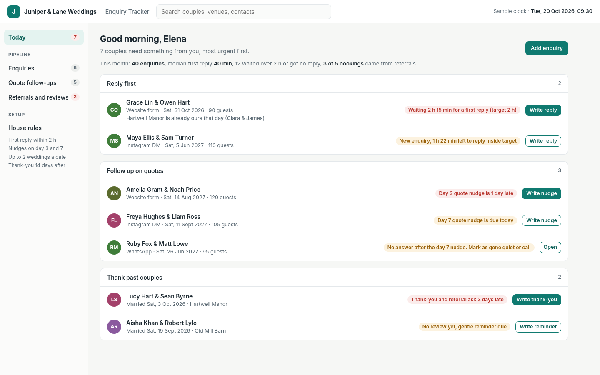

# Tool 03 — Wedding Enquiry Tracker

**Industry:** wedding planners · **Status:** Built (local, sample data, not deployed) · **Validation:** L0, no planner has confirmed it yet
**App:** http://localhost:3003 · no API or database port is used

Real build, sample data. Every couple, venue and number is fictional. Not affiliated with or representative of any specific company.



## What this system does
It answers one question each morning: **which couples need something from us right now?** Every enquiry sits in one list, whatever channel it came from. The tracker checks the date against the team's capacity, times the day 3 and day 7 quote nudges, and reminds you to thank past couples and ask for a referral 14 days after the wedding. Each step comes with a draft message to copy.

## Who it is for
Owners and lead planners at small wedding planning companies, especially with two or more planners.

## Business problem
Bookings are lost quietly. A couple DMs on Friday night, hears back on Tuesday and has already booked someone else. Quotes go out and nobody follows up, and happy couples are never asked to refer friends. It's a speed and follow-up problem, not a lead problem. (How big a problem this is hasn't been measured; see [problem validation](docs/10-problem-validation.md).)

## Workflow
New enquiry → first reply (target 2 h) → quote → day 3 nudge → day 7 nudge → booked, lost or gone quiet. After the wedding: thank-you with a review and referral ask on day 14, then one reminder 7 days later.

## Features
- **Today:** a ranked list of who to reply to, who to nudge and who to thank, with the reason in plain words.
- **Enquiries:** one table for Instagram, WhatsApp, the website form, email and referrals, with search (`/`), status tabs and a channel filter.
- **Date check:** up to 2 weddings a date, the same venue on the same date is blocked, and other open quotes for that date show as a warning. It names the free planner.
- **Add enquiry:** validation, a live date check, and a duplicate warning (names in either order, or the same phone or handle).
- **Quote follow-ups:** day 3 and day 7 steps per quote; each nudge waits for the previous one; flagged as gone quiet 3 days after the last.
- **Referrals and reviews:** past couples, the day 14 ask, one reminder, and which enquiries each couple referred.
- **History** on every enquiry. Booking a date holds it for the next enquiry.
- **House rules:** the rules in plain sentences, plus a sample data reset.

Not included, on purpose: sending messages (you copy the draft), inbox sync, vendor boards and payments.

## Architecture
```text
Manual entry / sample-data/*.json ─▶ config/rules.json ─▶ src/rules.js (pure, tested) ─▶ src/app.js screens + draft messages
```
One HTML page, plain ES modules, no framework, no build step, no backend. There's no AI, because every decision is a date comparison. Details: [docs/05-architecture.md](docs/05-architecture.md).

## Setup
```bash
cd tool-03-wedding-planners
npm install        # only needed for the browser tests
npm run dev        # http://localhost:3003  (npm run demo is the same)
```
Opening `index.html` straight from disk won't work: browsers block loading the JSON files over `file://`.

## Environment variables
See `.env.example`. `PORT=3003` (fixed) and an optional `CHROME_PATH` for the browser tests. There are no secrets.

## Database
None. Sample data loads from `sample-data/`; your changes are saved in this browser's `localStorage`. House rules → Reset sample data clears them. The sample clock is fixed at Tue 20 Oct 2026, 09:30 so the demo is repeatable; add `?clock=live` to use the real time.

## Integrations
None live. A website-form webhook and calendar sync are on the roadmap.

## Testing
```bash
npm test           # 56 rule and data tests (node --test, no install needed)
npm run test:e2e   # 10 browser tests in Chrome via playwright-core
npm run test:all   # both
```
They cover each rule and its boundaries, bad and missing input, duplicates, empty data and 2,000 enquiries, plus the full reply → quote → nudge → booked flow, persistence after a reload, the phone layout, keyboard use and accessible names. The log is in [docs/06-build-log.md](docs/06-build-log.md).

## Deployment
Any static host serving `index.html`, `src/`, `config/` and `sample-data/`. Not deployed.

## White-label configuration
Everything client-specific is in [`config/rules.json`](config/rules.json): company name, initial, brand colour, currency, locale, sender name, team, weddings per date, the same-venue rule, the reply target, nudge days, the gone-quiet wait, the referral timing, channels and every message template.

## Customization guide
1. Edit `config/rules.json`. 2. Replace `sample-data/` with the client's export (same fields; `npm test` checks the data). 3. Change the templates to the planner's own voice. 4. Run `npm run test:all`.

## Commercialization opportunities
Small budgets and strong incumbents (HoneyBook, Aisle Planner), so this is mainly a teaching and audience tool. See [docs/07-commercialization.md](docs/07-commercialization.md).

## Future roadmap
Website-form webhook · weekend on-call routing · venue-referral report (the learner exercise) · hosted storage and multiple users · a weekly digest.

## Docs
[Research](docs/01-industry-research.md) · [Opportunities](docs/02-opportunity-discovery.md) · [Spec](docs/03-product-spec.md) · [UX](docs/04-ux-design.md) · [Architecture](docs/05-architecture.md) · [Build log](docs/06-build-log.md) · [Commercialization](docs/07-commercialization.md) · [Teaching playbook](docs/08-teaching-playbook.md) · [Design system](docs/09-design-system.md) · [Problem validation](docs/10-problem-validation.md)
